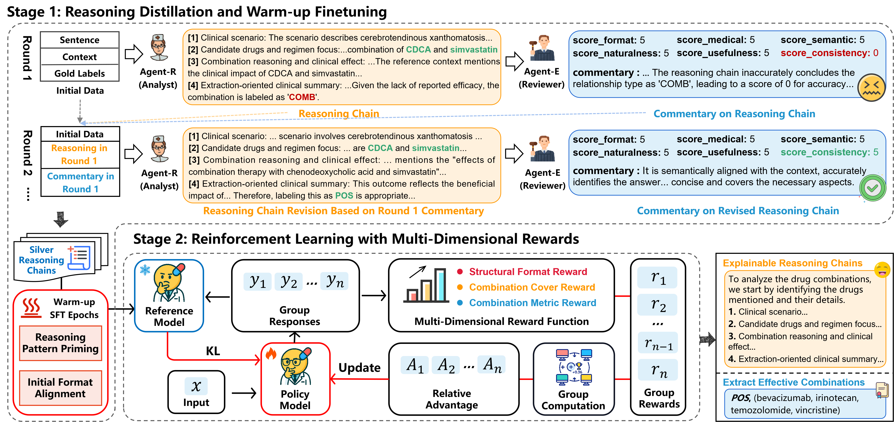

# RexDrug: Reliable Multi-Drug Combination Extraction through Reasoning-Enhanced LLMs

## Overview
Automated Drug Combination Extraction (DCE) from large-scale biomedical literature is important for precision medicine and pharmacological research. However, existing extraction methodologies predominantly focus on binary interactions. When tasked with complex, variable-length n-ary pharmacological relationships, these methods often struggle to capture the underlying compatibility logic between multiple agents and lack interpretability. To address these limitations, we introduce RexDrug, an end-to-end n-ary drug combination extraction framework that leverages Reinforcement Learning (RL) to enhance the reasoning capabilities of Large Language Models (LLMs). Within this framework, a two-stage training strategy is implemented: first, a multi-agent collaborative system is utilized to automatically generate reasoning traces that emulate expert logic, forming the basis for Supervised Fine-Tuning (SFT). Subsequently, we employ a multi-dimensional reward function specifically tailored for drug combination identification to further refine reasoning quality and extraction precision. Experimental results show that RexDrug outperforms current state-of-the-art baselines in extraction accuracy, with strong robustness. Human expert evaluation further indicates that RexDrug produces coherent medical reasoning while correctly identifying complex therapeutic regimens. These findings demonstrate the reliability of RexDrug as a scalable and interpretable tool for large-scale biomedical literature mining



## Quick Start
This example demonstrates how to run **RexDrug** on a drug combination relation extraction task.  
Given a biomedical sentence and its surrounding paragraph as context, the model identifies drug combinations and classifies their relation type (**POS / NEG / COMB / NO_COMB**) with reasoning.

The pretrained RexDrug checkpoints are available on Hugging Face: [DUTIR-BioNLP/RexDrug-base](https://huggingface.co/DUTIR-BioNLP/RexDrug-base) and [DUTIR-BioNLP/RexDrug-adapter](https://huggingface.co/DUTIR-BioNLP/RexDrug-adapter)

You can download or directly load these checkpoints from Hugging Face when running the demo script `run_rexdrug_demo.py`.

```bash
python run_rexdrug_demo.py
```

## Project Structure

```
RexDrug/
├── README.md                    # This file
├── setup.py                     # Installation script
├── requirements.txt             # Python dependencies
├── run_rexdrug_demo.py          # Quick start demo for RexDrug inference
│
├── datasets/                    # Datasets and data processing
│   ├── DDI13/                   # DDI2013 dataset
│   │   ├── DDI2013/             # Raw data (train.jsonl, test.jsonl)
│   │   ├── cot_data_get/        # CoT generation & evaluation scripts
│   │   ├── sft_cot_data/        # SFT format with CoT (generated)
│   │   ├── grpo_cot_data/       # GRPO format with CoT (generated)
│   │   └── sft_only_re/         # SFT format without CoT
│   └── DrugComb/                # DrugComb dataset
│       ├── ord_data/            # Raw data (train.jsonl, test.jsonl)
│       ├── cot_data_get/        # CoT generation & evaluation scripts
│       ├── sft_cot_data/        # SFT format with CoT (included)
│       ├── grpo_cot_data_v2/    # GRPO format with CoT (included)
│       └── sft_only_re/         # SFT format without CoT
│
├── swift/                       # ms-swift framework core
│   └── rewards/
│       └── grpo_reward.py       # Custom GRPO reward functions
│
├── scripts/                     # Training and inference scripts
│   ├── config.sh                # Configuration file
│   ├── stage1_sft_train.sh      # Stage 1: SFT training
│   ├── stage2_merge_lora.sh     # Stage 2: Merge LoRA
│   ├── stage3_grpo_train.sh     # Stage 3: GRPO training
│   ├── inference.sh             # Inference script
│   └── run_full_pipeline.sh     # Full pipeline (all stages)
│
├── eval/                        # Evaluation scripts
│   ├── eval_files_drugcomb.py   # DrugComb evaluation
│   └── eval_files_ddi.py        # DDI13 evaluation
│
└── outputs/                     # Training outputs (generated)
```

## Requirements

- Python 3.10.0
- PyTorch 2.8.0
- CUDA 12.8

## Installation

### 1. Create a virtual environment

```bash
conda create -n drugcomb python=3.10
conda activate drugcomb
```

### 2. Install dependencies

```bash
cd RexDrug
pip install -e .
pip install vllm==0.11.0
```

### 3. Configure model paths

Edit `scripts/config.sh` and set the paths to your local models:

```bash
# LLaMA 3.1-8B-Instruct model path
export LLAMA_MODEL_PATH="/path/to/llama3.1-8b-instruct"

# Qwen 2.5-7B-Instruct model path
export QWEN_MODEL_PATH="/path/to/Qwen2.5-7B-Instruct"
```

## Data Preparation

### DrugComb Dataset

The DrugComb CoT data is **pre-generated and included** in:
- `datasets/DrugComb/sft_cot_data/` (SFT format, 1098 training + 272 test samples)
- `datasets/DrugComb/grpo_cot_data_v2/` (GRPO format, 1098 training + 272 test samples)

No additional data preparation is needed for DrugComb.

To regenerate CoT data from scratch (optional):

```bash
# Step 1: Generate CoT reasoning chains
#   --gen-model: model for CoT generation (default: gpt-4o)
#   --eval-model: model for CoT quality evaluation (default: gpt-5.1)
python datasets/DrugComb/cot_data_get/get_cot_data_for_rel_ext.py \
    --input datasets/DrugComb/ord_data/train.jsonl \
    --output datasets/DrugComb/cot_data_get/output \
    --api-key YOUR_API_KEY \
    --gen-model gpt-4o \
    --eval-model gpt-5.1 \
    --threads 50

# Step 2: Convert to SFT format
python datasets/DrugComb/sft_cot_data/convert_cot_to_sft.py \
    --input datasets/DrugComb/cot_data_get/output/train_final_cot.jsonl \
    --output datasets/DrugComb/sft_cot_data/drugcomb_train.jsonl

# Step 3: Convert to GRPO format
python datasets/DrugComb/grpo_cot_data_v2/convert_cot_to_grpo.py \
    --input datasets/DrugComb/cot_data_get/output/train_final_cot.jsonl \
    --output datasets/DrugComb/grpo_cot_data_v2/train_drugcomb.jsonl
```

### DDI13 Dataset

The DDI13 raw data is included in `datasets/DDI13/DDI2013/`. CoT data must be generated before training:

```bash
# Step 1: Generate CoT reasoning chains
#   --gen-model: model for CoT generation (default: gpt-4o)
#   --eval-model: model for CoT quality evaluation (default: gpt-5.1)
python datasets/DDI13/cot_data_get/get_cot_data.py \
    --input datasets/DDI13/DDI2013/train.jsonl \
    --output datasets/DDI13/cot_data_get/output \
    --api-key YOUR_API_KEY \
    --gen-model gpt-4o \
    --eval-model gpt-5.1 \
    --threads 10

# Step 2: Convert to SFT format
python datasets/DDI13/cot_data_get/convert_cot_to_sft.py \
    --input datasets/DDI13/cot_data_get/output/final_cot_YYYYMMDD_HHMMSS.jsonl \
    --output datasets/DDI13/sft_cot_data/train_ddi.jsonl

# Step 3: Convert to GRPO format
python datasets/DDI13/cot_data_get/convert_cot_to_grpo.py \
    --input datasets/DDI13/cot_data_get/output/final_cot_YYYYMMDD_HHMMSS.jsonl \
    --output datasets/DDI13/grpo_cot_data/train_ddi.jsonl
```

## Usage

### Run the Full Pipeline

The easiest way to run the complete training pipeline:

```bash
cd RexDrug

# Run with LLaMA on DrugComb dataset
bash scripts/run_full_pipeline.sh llama drugcomb 42 0

# Run with Qwen on DDI13 dataset
bash scripts/run_full_pipeline.sh qwen ddi 42 0
```

**Arguments:**
- `model_type`: `llama` or `qwen`
- `dataset`: `drugcomb` or `ddi`
- `seed`: Random seed (default: 42)
- `gpu`: GPU device ID (default: 0)

### Run Individual Stages

#### Stage 1: SFT Training

```bash
bash scripts/stage1_sft_train.sh llama drugcomb 42 0
```

#### Stage 2: Merge LoRA

Note: ms-swift creates output directories with format `v0-YYYYMMDD-HHMMSS/checkpoint-xxx`.

```bash
# Find the checkpoint path first
ls outputs/stage1_sft/llama3_1_sft_cot_drugcomb_seed42/v0-*/checkpoint-*

# Then run merge
bash scripts/stage2_merge_lora.sh outputs/stage1_sft/llama3_1_sft_cot_drugcomb_seed42/v0-YYYYMMDD-HHMMSS/checkpoint-xxx
```

#### Stage 3: GRPO Training

```bash
bash scripts/stage3_grpo_train.sh outputs/stage2_merged/llama3_1_drugcomb_seed42 llama drugcomb 42 0
```

#### Inference

```bash
# Find the GRPO checkpoint
ls outputs/stage3_grpo/llama3_1_grpo_cot_drugcomb_seed42/v0-*/checkpoint-*

# Run inference
bash scripts/inference.sh outputs/stage3_grpo/llama3_1_grpo_cot_drugcomb_seed42/v0-YYYYMMDD-HHMMSS/checkpoint-xxx drugcomb results 0
```

## GRPO Reward Functions

Custom reward functions are defined in `swift/rewards/grpo_reward.py`. The reward functions guide the GRPO training process:

| Reward Function | Description |
|-----------------|-------------|
| `*_cot_format` | Validates `<think>` and `<answer>` tag structure |
| `*_cot_think` | Checks reasoning quality in think section |
| `*_coverage_cot` | Measures entity coverage (Jaccard similarity) |
| `*_accuracy_cot` | F1-based accuracy reward |

## Configuration

Key hyperparameters can be modified in `scripts/config.sh`:

| Parameter | SFT Stage | GRPO Stage |
|-----------|-----------|------------|
| LoRA Rank | 16 | 16 |
| LoRA Alpha | 32 | 32 |
| Learning Rate | 1e-5 | 1e-6 |
| Epochs | 10 | 20 |
| Batch Size | 1 | 4 |

### Note on Template Names

In the training scripts, the `--template` parameter is set to `llama3_2` for LLaMA 3.1-8B-Instruct. This is a naming convention defined by the ms-swift framework where `llama3_2` refers to the chat template format used by the LLaMA 3.x Instruct model family (including 3.1). It does not imply that a LLaMA 3.2 model is used. Similarly, `qwen2_5` is the ms-swift template name for Qwen 2.5 models.

## Troubleshooting

### CUDA Out of Memory

- Reduce `vllm_gpu_memory_utilization` in scripts
- Add `--gradient_checkpointing true`
- Reduce batch size

### Model Path Not Found

Ensure base models are downloaded and paths are correctly set in `scripts/config.sh`.

## Case Studies

The following case studies illustrate both the strengths and the remaining
failure modes of RexDrug. The five DDI13 examples were selected for qualitative
analysis: three are exact predictions and two are representative errors. This
is a deliberately selected set and should not be interpreted as an estimate of
the overall error rate. During inference, RexDrug received only the task
instructions and the target sentence. Gold annotations were used only for
post-hoc evaluation.

| Case | Main challenge | RexDrug result |
|---|---|---|
| `DDI-MedLine.d143.s3` | Pharmacokinetic evidence and relation-type selection | Exact |
| `DDI-MedLine.d218.s8` | One-to-many relation decomposition | Exact |
| `DDI-MedLine.d164.s1` | Clinical outcome versus the lexical cue "mechanism" | Exact |
| `DDI-MedLine.d161.s6` | Long chemical names and treatment-control comparison | False negative |
| `DDI-MedLine.d194.s15` | Drug/protein entity boundary | False positive |

### DDI13 Case 1: CYP2C19-mediated interaction

**Sample:** `DDI-MedLine.d143.s3`

**Target sentence**

```text
Concomitant use of omeprazole and clopidogrel was found to decrease the exposure (AUC) to clopidogrel's active metabolite by 50% and to sharply increase platelet reactivity, as a result of inhibition by omeprazole of CYP2C19, a cytochrome P450 (CYP) enzyme.
```

**Gold annotation**

```json
[
  {
    "type": "mechanism",
    "ent_set": ["omeprazole", "clopidogrel"]
  }
]
```

<details>
<summary><strong>RexDrug reasoning and prediction</strong></summary>

```text
<think>
[1] Sentence-level pharmacological scenario
- The sentence describes a pharmacokinetic mechanism in a clinical setting involving the concomitant use of omeprazole and clopidogrel.
- It explains how omeprazole decreases the exposure to clopidogrel's active metabolite by inhibiting the CYP2C19 enzyme, indicating an extractable DDI.

[2] Candidate entities and pair focus
- The relevant drug names in the sentence are "omeprazole" and "clopidogrel."
- These two drugs are connected in the sentence through a pharmacokinetic interaction, where omeprazole affects the metabolism of clopidogrel.

[3] DDI evidence and relation classification
- The sentence provides evidence of a pharmacokinetic mechanism by stating that omeprazole decreases the exposure (AUC) to clopidogrel's active metabolite.
- The mechanism is attributed to the inhibition by omeprazole of the CYP2C19 enzyme, which is responsible for metabolizing clopidogrel.
- This explicit description of a pharmacokinetic alteration classifies the interaction between omeprazole and clopidogrel as a "mechanism."

[4] Extraction-oriented clinical summary
- The interaction between omeprazole and clopidogrel is classified as a mechanism due to omeprazole's inhibition of the CYP2C19 enzyme, leading to decreased exposure to clopidogrel's active metabolite.
- This classification reflects the pharmacokinetic process described in the sentence, which affects clopidogrel's metabolism.
- The extracted relation is a mechanism between omeprazole and clopidogrel.
</think>

<answer>
[{"type":"mechanism","ent_set":["omeprazole","clopidogrel"]}]
</answer>
```

</details>

**Interpretation.** RexDrug correctly followed the complete pharmacokinetic
chain: omeprazole inhibits CYP2C19, exposure to the active clopidogrel metabolite
decreases, and platelet reactivity increases. The explicit enzyme inhibition and
exposure change support `mechanism`, rather than a second `effect` relation or an
unsupported management recommendation.

### DDI13 Case 2: One-to-many clinical effects

**Sample:** `DDI-MedLine.d218.s8`

**Target sentence**

```text
Warfarin users had an increased odds ratio of gastrointestinal bleeding upon initiation of citalopram (OR = 1.73 [95% CI, 1.25-2.38]), fluoxetine (OR = 1.63 [95% CI, 1.11-2.38]), paroxetine (OR = 1.64 [95% CI, 1.27-2.12]), amitriptyline (OR = 1.47 [95% CI, 1.02-2.11]).
```

**Gold annotation**

```json
[
  {"type": "effect", "ent_set": ["Warfarin", "citalopram"]},
  {"type": "effect", "ent_set": ["Warfarin", "fluoxetine"]},
  {"type": "effect", "ent_set": ["Warfarin", "paroxetine"]},
  {"type": "effect", "ent_set": ["Warfarin", "amitriptyline"]}
]
```

<details>
<summary><strong>RexDrug reasoning and prediction</strong></summary>

```text
<think>
[1] Sentence-level pharmacological scenario
- The sentence describes a clinical consequence: an increased odds ratio of gastrointestinal bleeding in Warfarin users upon initiation of specific antidepressants.
- It primarily provides evidence of clinical effects, indicating extractable DDIs.

[2] Candidate entities and pair focus
- The relevant drug names are "Warfarin," "citalopram," "fluoxetine," "paroxetine," and "amitriptyline."
- Each antidepressant is connected to Warfarin in the context of an increased odds ratio of gastrointestinal bleeding, forming distinct binary pairs: Warfarin-citalopram, Warfarin-fluoxetine, Warfarin-paroxetine, and Warfarin-amitriptyline.

[3] DDI evidence and relation classification
- The phrase "increased odds ratio of gastrointestinal bleeding" serves as the trigger for a clinical consequence.
- For each pair (Warfarin-citalopram, Warfarin-fluoxetine, Warfarin-paroxetine, Warfarin-amitriptyline), the increased odds ratio of gastrointestinal bleeding is classified as an effect, as it describes a clinical consequence without detailing a pharmacokinetic mechanism or management instruction.

[4] Extraction-oriented clinical summary
- The initiation of citalopram, fluoxetine, paroxetine, or amitriptyline in Warfarin users is associated with an increased clinical risk of gastrointestinal bleeding.
- These interactions are classified as effects due to the observed increase in odds ratio of gastrointestinal bleeding.
- The extracted DDIs are: Warfarin-citalopram (effect), Warfarin-fluoxetine (effect), Warfarin-paroxetine (effect), and Warfarin-amitriptyline (effect).
</think>

<answer>
[{"type":"effect","ent_set":["Warfarin","citalopram"]},{"type":"effect","ent_set":["Warfarin","fluoxetine"]},{"type":"effect","ent_set":["Warfarin","paroxetine"]},{"type":"effect","ent_set":["Warfarin","amitriptyline"]}]
</answer>
```

</details>

**Interpretation.** RexDrug decomposed the one-to-many statement into four
binary relations centered on warfarin. It did not introduce relations among the
four antidepressants, and it classified the increased bleeding risk as a
clinical `effect` without inventing a pharmacokinetic mechanism.

### DDI13 Case 3: Clinical outcome versus a lexical cue

**Sample:** `DDI-MedLine.d164.s1`

**Target sentence**

```text
Although it was previously reported that lapatinib combined with Herceptin improved the progression-free survival rate compared with lapatinib alone for patients with Herceptin-refractory HER2-positive metastatic breast cancer, the mechanism is purported to be an antiproliferative effect relating to the synergism of these two agents.
```

**Gold annotation**

```json
[
  {
    "type": "effect",
    "ent_set": ["lapatinib", "Herceptin"]
  }
]
```

<details>
<summary><strong>RexDrug reasoning and prediction</strong></summary>

```text
<think>
[1] Sentence-level pharmacological scenario
- The sentence describes a clinical observation where the combination of lapatinib and Herceptin improves progression-free survival in patients with HER2-positive metastatic breast cancer.
- It primarily provides a clinical consequence of the drug combination, specifically an observed synergistic antiproliferative effect, indicating an extractable DDI.

[2] Candidate entities and pair focus
- The relevant drug names in the sentence are "lapatinib" and "Herceptin."
- These two drugs are connected in the context of a combination therapy that results in a clinical consequence, specifically improved progression-free survival.

[3] DDI evidence and relation classification
- The key phrase indicating the interaction is "lapatinib combined with Herceptin improved the progression-free survival rate," which describes a clinical consequence.
- The sentence further explains the mechanism as an "antiproliferative effect relating to the synergism of these two agents," but the primary focus is on the observed clinical outcome.
- The observed improvement in progression-free survival is classified as an "effect" because it is a clinical consequence of the drug combination.

[4] Extraction-oriented clinical summary
- The combination of lapatinib and Herceptin results in an improved progression-free survival rate, which is a clinical effect in patients with HER2-positive metastatic breast cancer.
- This interaction is classified as an "effect" due to the observed clinical outcome.
- The extracted relation is between "lapatinib" and "Herceptin," with the type "effect."
</think>

<answer>
[{"type":"effect","ent_set":["lapatinib","Herceptin"]}]
</answer>
```

</details>

**Interpretation.** RexDrug prioritized the reported progression-free-survival
improvement and synergistic antiproliferative outcome over the surface word
"mechanism." The sentence does not specify a molecular pathway,
pharmacokinetic process, or exposure change, so `effect` is the appropriate
DDI13 relation.

### DDI13 Case 4: False negative in a treatment-control comparison

**Sample:** `DDI-MedLine.d161.s6`

**Target sentence**

```text
These behavioural observations were consistent with in vivo positron emission tomography dopamine transporter imaging data, and with post-mortem stereological counts of midbrain dopaminergic neurons, as well as striatal intensity measurements of dopamine transporter and tyrosine hydroxylase immunoreactivity, which were all significantly higher in 1-methyl-4-phenyl-1,2,3,6-tetrahydropyridine/3-[(2-methyl-1,3-thiazol-4-yl) ethynyl] pyridine-treated animals than in 1-methyl-4-phenyl-1,2,3,6-tetrahydropyridine/vehicle-treated monkeys.
```

**Gold annotation**

```json
[
  {
    "type": "effect",
    "ent_set": [
      "1-methyl-4-phenyl-1,2,3,6-tetrahydropyridine",
      "3-[(2-methyl-1,3-thiazol-4-yl) ethynyl] pyridine"
    ]
  }
]
```

<details>
<summary><strong>RexDrug reasoning and prediction</strong></summary>

```text
<think>
[1] Sentence-level pharmacological scenario
- The sentence describes an experimental study involving animal models, specifically focusing on behavioral observations and various imaging and post-mortem analyses.
- It primarily provides background information on an animal study without stating an interaction, pharmacokinetic mechanism, clinical consequence, or management instruction, and no extractable DDI is present.

[2] Candidate entities and pair focus
- The drug names mentioned are "1-methyl-4-phenyl-1,2,3,6-tetrahydropyridine" and "3-[(2-methyl-1,3-thiazol-4-yl)ethynyl]pyridine."
- These names are part of a comparison of treated animals versus vehicle-treated controls, but they are not connected by an explicit interaction, pharmacokinetic change, or clinical consequence.

[3] DDI evidence and relation classification
- The sentence lacks an explicit statement of interaction, pharmacokinetic mechanism, clinical consequence, or management instruction between the drug names.
- The focus is on experimental observations and comparisons in animal models, without indicating any interaction between the drugs.
- Therefore, the sentence does not provide evidence for an extractable DDI, warranting a classification of NO_COMB.

[4] Extraction-oriented clinical summary
- The sentence compares the effects of "1-methyl-4-phenyl-1,2,3,6-tetrahydropyridine" and "3-[(2-methyl-1,3-thiazol-4-yl)ethynyl]pyridine" in animal models, focusing on experimental outcomes.
- No explicit interaction, pharmacokinetic mechanism, or clinical consequence is stated, leading to the conclusion that there is no extractable DDI.
- The relation is classified as NO_COMB, as the drug names are mentioned in an experimental context without an interaction.
</think>

<answer>
[{"type":"NO_COMB","ent_set":[]}]
</answer>
```

</details>

**Error analysis.** The combination-treated group differed from the control
group only by the second compound, and multiple imaging and post-mortem outcomes
were significantly higher. These observations constitute an experimental
consequence of adding the second compound. RexDrug recognized both chemical
entities but treated the result as background information, producing a false
negative.

### DDI13 Case 5: False positive caused by entity-type drift

**Sample:** `DDI-MedLine.d194.s15`

**Target sentence**

```text
The siRNA knockdown of p27(Kip1) decreased dasatinib- and paclitaxel-induced apoptosis compared with a negative control siRNA (sub-G1 fraction, control siRNA vs. p27(Kip1) siRNA: 42.5% vs. 20.1%, difference = 22.4%, 95% CI = 20.1% to 24.7%, P = .017).
```

**Gold annotation**

```json
[
  {
    "type": "NO_COMB",
    "ent_set": []
  }
]
```

<details>
<summary><strong>RexDrug reasoning and prediction</strong></summary>

```text
<think>
[1] Sentence-level pharmacological scenario
- The sentence describes an experimental setting where siRNA knockdown of p27(Kip1) is used to study its effect on apoptosis induced by dasatinib and paclitaxel.
- The primary focus is on an experimental consequence, specifically the decrease in apoptosis induced by dasatinib and paclitaxel when p27(Kip1) is knocked down, indicating an extractable DDI.

[2] Candidate entities and pair focus
- The relevant drug names are "dasatinib" and "paclitaxel," both connected to the experimental consequence of apoptosis reduction.
- The sentence compares the effects of these drugs in the context of p27(Kip1) knockdown, linking each drug to the observed experimental outcome.

[3] DDI evidence and relation classification
- For the pair "dasatinib" and "p27(Kip1)," the sentence states that siRNA knockdown of p27(Kip1) decreased dasatinib-induced apoptosis, indicating an experimental consequence.
- Similarly, for "paclitaxel" and "p27(Kip1)," the sentence states that siRNA knockdown of p27(Kip1) decreased paclitaxel-induced apoptosis, also indicating an experimental consequence.
- Both pairs are classified as "effect" because the sentence describes the experimental outcome of reduced apoptosis without detailing a pharmacokinetic mechanism or providing a clinical management instruction.

[4] Extraction-oriented clinical summary
- The siRNA knockdown of p27(Kip1) decreased dasatinib-induced apoptosis, classified as an effect.
- The siRNA knockdown of p27(Kip1) also decreased paclitaxel-induced apoptosis, classified as an effect.
- Both findings represent experimental consequences of reduced apoptosis, warranting classification as effect for both dasatinib and paclitaxel interactions with p27(Kip1).
</think>

<answer>
[{"type":"effect","ent_set":["dasatinib","p27(Kip1)"]},{"type":"effect","ent_set":["paclitaxel","p27(Kip1)"]}]
</answer>
```

</details>

**Error analysis.** The sentence describes p27(Kip1) knockdown as a regulator
of apoptosis induced separately by dasatinib and paclitaxel; it does not state a
binary interaction between the two drugs. RexDrug initially identified the two
drug entities correctly, but later treated the protein p27(Kip1) as a drug and
constructed two invalid pairs. The trace therefore exposes an entity-type drift
between candidate identification and final relation construction.

## RexDrug-to-MultiComb Workflow Examples

RexDrug and MultiComb address consecutive, but different, stages of drug
combination analysis. RexDrug extracts evidence-supported relations from text.
After manual verification, drug-name normalization, and cell-line matching,
MultiComb predicts continuous synergy and sensitivity values for a predefined
drug pair and cancer cell line. An `effect` relation in DDI13 and a MultiComb
synergy score are different endpoints and must not be treated as equivalent.

The supplementary material presents the paclitaxel-SAHA/SKOV3 workflow. The two
additional repository examples are provided below. Both use the O'Neil record's
held-out fold, and both drug input orders are reported because the reproduced
MultiComb model is order-sensitive.

### Workflow Case 1: Geldanamycin and paclitaxel in A2780

**Source:** PMID [`27629142`](https://pubmed.ncbi.nlm.nih.gov/27629142/), DOI
[`10.1007/s13277-016-5297-2`](https://doi.org/10.1007/s13277-016-5297-2)

**Literature input to RexDrug**

```text
Geldanamycin (GA), an inhibitor of Hsp90, sustained activation of the p38/H2AX axis, and A2780T cells were shown to be more sensitive to GA compared to A2780 cells. Furthermore, treatment of A2780 and A2780T cells with GA significantly enhanced sensitivity to paclitaxel.
```

<details>
<summary><strong>RexDrug reasoning and prediction</strong></summary>

```text
<think>
[1] Sentence-level pharmacological scenario
- The sentence describes an experimental setting involving the effects of Geldanamycin (GA) on A2780 and A2780T cells, focusing on its ability to enhance sensitivity to paclitaxel.
- It primarily reports an experimental consequence, indicating an interaction between GA and paclitaxel, which is extractable as a DDI.

[2] Candidate entities and pair focus
- The relevant drug names are "Geldanamycin" (GA) and "paclitaxel."
- These names are connected in the sentence by the statement that treatment with GA significantly enhances sensitivity to paclitaxel in A2780 and A2780T cells.

[3] DDI evidence and relation classification
- The key phrase indicating the interaction is "treatment of A2780 and A2780T cells with GA significantly enhanced sensitivity to paclitaxel."
- This phrase describes an experimental consequence, where GA makes the cells more sensitive to paclitaxel, classifying the interaction as an effect.
- There is no mention of a pharmacokinetic mechanism or explicit management instruction, confirming the classification as an effect.

[4] Extraction-oriented clinical summary
- The interaction between Geldanamycin and paclitaxel is classified as an effect, as GA enhances the sensitivity of A2780 and A2780T cells to paclitaxel in the experimental setting.
- This classification reflects the observed experimental consequence without implying clinical relevance or specific management guidance.
</think>

<answer>
[{"type":"effect","ent_set":["Geldanamycin","paclitaxel"]}]
</answer>
```

</details>

RexDrug resolved `GA` to Geldanamycin and extracted an experimental `effect`.
The verified entities were then normalized to the MultiComb vocabulary. A2780
was selected because it is explicitly present in the source and exactly matches
an O'Neil cell-line record; the paclitaxel-resistant derivative A2780T was not
silently mapped to A2780.

**Normalized MultiComb input**

```json
{
  "case_id": "C02",
  "drug1": "PACLITAXEL",
  "drug2": "GELDANAMYCIN",
  "cell_line": "A2780",
  "held_out_fold": 2,
  "orders": [
    ["PACLITAXEL", "GELDANAMYCIN"],
    ["GELDANAMYCIN", "PACLITAXEL"]
  ]
}
```

**MultiComb predictions and O'Neil reference**

```json
{
  "AB": {
    "order": "PACLITAXEL -> GELDANAMYCIN",
    "synergy_prediction": -15.4016,
    "sensitivity_prediction": 37.5090
  },
  "BA": {
    "order": "GELDANAMYCIN -> PACLITAXEL",
    "synergy_prediction": -14.7081,
    "sensitivity_prediction": 37.9643
  },
  "bidirectional_mean": {
    "synergy": -15.0548,
    "sensitivity": 37.7366
  },
  "oneil_reference": {
    "synergy": -16.7637,
    "sensitivity": 35.6115
  }
}
```

The two input orders produced similar values. The bidirectional mean differed
from the O'Neil reference by `1.7089` for synergy and `2.1251` for sensitivity.
The literature-reported enhancement and the negative O'Neil synergy value are
not contradictory because they arise from different experimental conditions,
doses, and endpoints.

### Workflow Case 2: MK-2206 and paclitaxel in SKOV3

**Source:** PMID [`25164962`](https://pubmed.ncbi.nlm.nih.gov/25164962/), DOI
[`10.1007/s00210-014-1032-y`](https://doi.org/10.1007/s00210-014-1032-y)

**Literature input to RexDrug**

```text
Here, we demonstrate the efficacy of an Akt inhibitor, MK-2206, in increasing the cytotoxic effect of either paclitaxel (Taxol) or cisplatin against the ovarian cancer cell lines SKOV3 (with constitutively active Akt) and ES2 (with inactive Akt).
```

<details>
<summary><strong>RexDrug reasoning and prediction</strong></summary>

```text
<think>
[1] Sentence-level pharmacological scenario
- The sentence describes an experimental setting where an Akt inhibitor, MK-2206, is tested for its ability to enhance the cytotoxic effects of paclitaxel or cisplatin against ovarian cancer cell lines.
- This is an experimental consequence, not a clinical claim, and it indicates an extractable DDI based on the observed increase in cytotoxicity.

[2] Candidate entities and pair focus
- The relevant drug names are "MK-2206," "paclitaxel," and "cisplatin."
- MK-2206 is connected with both paclitaxel and cisplatin in the context of increasing their cytotoxic effects.
- Paclitaxel and cisplatin are mentioned as separate entities but are not connected to each other in a way that suggests an interaction in this sentence.

[3] DDI evidence and relation classification
- The phrase "increasing the cytotoxic effect" indicates an experimental consequence where MK-2206 enhances the cytotoxicity of paclitaxel and cisplatin.
- For the pair MK-2206 and paclitaxel, the evidence is the increase in cytotoxic effect, classifying this as an effect.
- Similarly, for MK-2206 and cisplatin, the increase in cytotoxic effect is the evidence, also classifying this as an effect.
- There is no explicit interaction statement or pharmacokinetic mechanism described, so the classification remains effect for both pairs.

[4] Extraction-oriented clinical summary
- MK-2206 increases the cytotoxic effect of paclitaxel against ovarian cancer cells, classified as an effect.
- MK-2206 increases the cytotoxic effect of cisplatin against ovarian cancer cells, also classified as an effect.
- The sentence supports two distinct binary DDIs, both classified as effect, reflecting the experimental consequence of enhanced cytotoxicity.
</think>

<answer>
[{"type":"effect","ent_set":["MK-2206","paclitaxel"]},{"type":"effect","ent_set":["MK-2206","cisplatin"]}]
</answer>
```

</details>

RexDrug correctly decomposed `either paclitaxel or cisplatin` into two binary
relations and did not create a paclitaxel-cisplatin pair or an unsupported
three-drug relation. Only the MK-2206-paclitaxel relation was passed downstream:
cisplatin is outside the 38-drug vocabulary used by this MultiComb reproduction.
SKOV3 was selected because both the source and O'Neil contain an exact SKOV3
record; ES2 was not replaced with another cell line.

**Normalized MultiComb input**

```json
{
  "case_id": "C04",
  "drug1": "PACLITAXEL",
  "drug2": "MK-2206",
  "cell_line": "SKOV3",
  "held_out_fold": 2,
  "orders": [
    ["PACLITAXEL", "MK-2206"],
    ["MK-2206", "PACLITAXEL"]
  ]
}
```

**MultiComb predictions and O'Neil reference**

```json
{
  "AB": {
    "order": "PACLITAXEL -> MK-2206",
    "synergy_prediction": 30.5182,
    "sensitivity_prediction": 27.2636
  },
  "BA": {
    "order": "MK-2206 -> PACLITAXEL",
    "synergy_prediction": 26.2183,
    "sensitivity_prediction": 29.3266
  },
  "bidirectional_mean": {
    "synergy": 28.3683,
    "sensitivity": 28.2951
  },
  "oneil_reference": {
    "synergy": 41.9583,
    "sensitivity": 30.0271
  }
}
```

Both orders predicted positive synergy, matching the direction of the O'Neil
reference, but the mean prediction underestimated its magnitude by `13.5901`.
The sensitivity mean was `1.7320` below the reference. This case demonstrates a
valid text-to-model connection while retaining the quantitative limitations of
the downstream prediction.

### Scope and limitations

These examples demonstrate technical interoperability, not prospective drug
combination discovery or experimental validation. RexDrug extracts relations
that have already been reported in literature. MultiComb scores predefined
drug-pair/cell-line inputs within its closed vocabulary. Drug normalization,
cell-line matching, and downstream eligibility were manually verified in these
examples. Neither the DDI13 relation label nor the MultiComb prediction serves
as a gold standard for the other task.

## License

Apache License 2.0

## Acknowledgments

Built upon the [ms-swift](https://github.com/modelscope/swift) framework by ModelScope.
